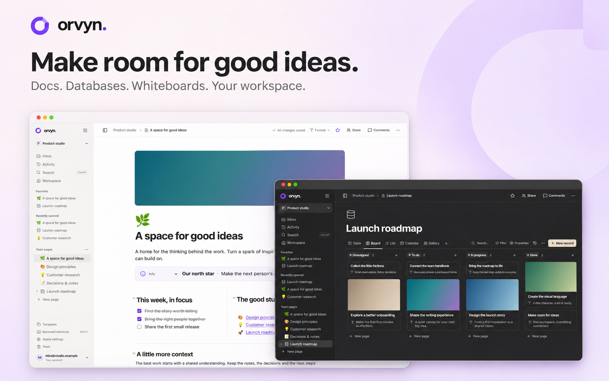
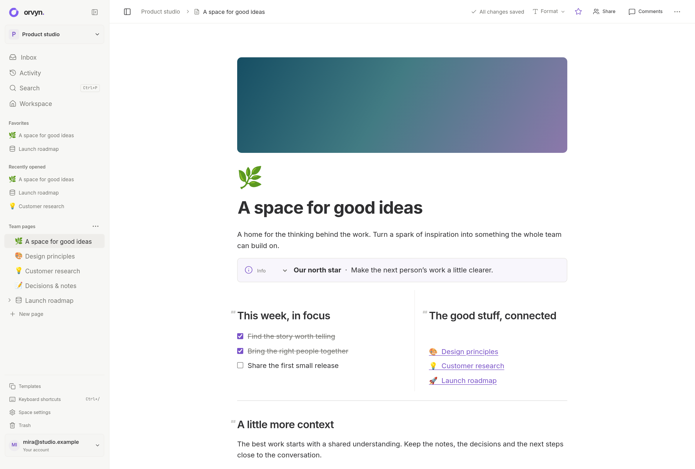
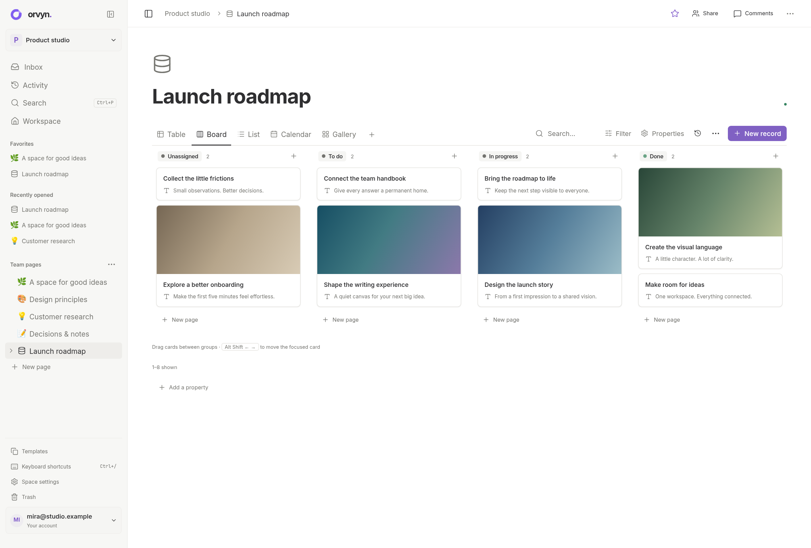

<p align="center">
  
</p>

<h1 align="center">orvyn.</h1>

<p align="center">
  <strong>Your knowledge. Organized.</strong><br>
  A self-hosted workspace for connected docs, databases and visual thinking.
</p>

<p align="center">
  <a href="https://github.com/Lucas-Gruber/orvyn/actions/workflows/ci.yml"></a>
  <a href="https://github.com/Lucas-Gruber/orvyn/releases/latest"></a>
  <a href="infrastructure/helm/orvyn/README.md"></a>
  <a href="docs/AUTHENTICATION.md"></a>
</p>

<p align="center">
  <a href="#a-workspace-that-keeps-the-context">Explore</a> ·
  <a href="#quick-start">Quick start</a> ·
  <a href="#deploy-on-kubernetes">Deploy</a> ·
  <a href="#documentation">Documentation</a> ·
  <a href="https://github.com/Lucas-Gruber/orvyn/releases">Releases</a>
</p>



## A workspace that keeps the context

The project brief. The research behind it. The board that moves it forward. Orvyn brings them together in a workspace you host yourself.

Write a quick note and grow it into a team handbook. Link a decision to the exact heading that explains it. Turn a database record into a full document, or embed a whiteboard beside the plan. Keep the work and the thinking behind it close together.

### From a blank page to a shared understanding

A block editor with `/` commands, Markdown paste and shortcuts, and H1–H4 headings. Build pages with columns, callouts, tables, code, [Mermaid diagrams](docs/MERMAID.md), images and checklists. Connect documents through stable heading links, preview cards and backlinks, then find them again with permission-aware search.

<picture>
  <source media="(prefers-color-scheme: dark)" srcset="docs/images/workspace-dark.png">
  
</picture>

### One database. More ways to see the work.

Switch between **table, board, list, calendar and gallery** views. Give every record its own page. Shape your workflow with templates, filters, relations, formulas and rollups, and open the details beside your board without losing your place.

<picture>
  <source media="(prefers-color-scheme: dark)" srcset="docs/images/roadmap-dark.png">
  
</picture>

<p align="center"><sub>Real application screenshots with fictional demo content. Light and dark previews follow your theme.</sub></p>

### The details that make a workspace useful

|                                  | What you can do                                                                                                                                                                |
| -------------------------------- | ------------------------------------------------------------------------------------------------------------------------------------------------------------------------------ |
| **Write together**               | Edit in real time with live carets and presence. Discuss the details in comments, mention teammates and follow replies in your inbox. [Collaboration →](docs/COLLABORATION.md) |
| **Connect the dots**             | Link to pages or individual headings, follow backlinks and search across the spaces you can access. [Document links →](docs/DOCUMENT_LINKS.md)                                 |
| **Think on a canvas**            | Sketch with Excalidraw whiteboards, add images and embed the canvas directly into a document. [Whiteboards →](docs/WHITEBOARDS.md)                                             |
| **Organize your way**            | Use private and team spaces, nested pages, favorites, page covers, keyboard shortcuts and seven themes. [Workspace →](docs/UI.md)                                              |
| **Share with intention**         | Publish reviewed snapshots of selected content, with optional passwords and expiry. Keep control over what readers receive. [Sharing →](docs/PUBLICATIONS.md)                  |
| **Bring your identity and data** | Use OIDC SSO, page permissions, local or S3-compatible file storage, Markdown imports and reviewed Markdown ZIP exports. [Authentication →](docs/AUTHENTICATION.md)            |

## Quick start

Try Orvyn on your own computer with **Node.js 24**, **pnpm 11.25** and **Docker Compose**. Start Docker Desktop, or use a running Docker Engine with the Compose plugin, then:

```sh
git clone https://github.com/Lucas-Gruber/orvyn.git
cd orvyn
pnpm install --frozen-lockfile
pnpm preview:local
```

When the terminal prints `ORVYN_LOCAL_PREVIEW_READY`, open **[localhost:5000](http://localhost:5000)** and create an account. The launcher prepares local configuration, starts the infrastructure and builds and starts the application. Your first launch takes a few minutes.

Press **Ctrl+C** to stop the application; your local infrastructure and data volumes are preserved. For development commands, another port or GitHub Codespaces, see [DEVELOPMENT.md](DEVELOPMENT.md).

## Deploy on Kubernetes

Orvyn ships a **versioned Helm chart**, native **AMD64 and ARM64** application images, and a **Rancher configuration form** with its own OIDC SSO section. Releases include signed artifacts, provenance and checksums.

Follow the [Helm deployment guide](infrastructure/helm/orvyn/README.md) to prepare your HTTPS origin, SMTP Secret, persistent storage and `orvyn-values.yaml`, then install the released chart:

```sh
helm upgrade --install orvyn oci://ghcr.io/lucas-gruber/charts/orvyn \
  --version 0.3.2 \
  --namespace orvyn --create-namespace \
  --values orvyn-values.yaml \
  --wait --wait-for-jobs --atomic --timeout 10m
```

Choose bundled or external PostgreSQL and Valkey, and local persistent-volume or S3-compatible attachment storage. The web service handles both API and collaboration traffic through one public HTTPS origin.

## Documentation

| Start here                                            | Go deeper                                                                                                                                                                 |
| ----------------------------------------------------- | ------------------------------------------------------------------------------------------------------------------------------------------------------------------------- |
| [Local setup & development](DEVELOPMENT.md)           | Build, run, test and work on the application.                                                                                                                             |
| [Helm & Rancher](infrastructure/helm/orvyn/README.md) | Installation, configuration forms, ingress, secrets, OIDC and upgrades.                                                                                                   |
| [Authentication](docs/AUTHENTICATION.md)              | Accounts, email, sessions, administrator setup and OIDC providers.                                                                                                        |
| [Permissions](docs/PERMISSIONS.md)                    | Team roles, inherited page access and restrictions.                                                                                                                       |
| [Editor & document links](docs/EDITOR_BLOCKS.md)      | [Links and headings](docs/DOCUMENT_LINKS.md), [tables](docs/EDITOR_TABLES.md), [layouts](docs/EDITOR_LAYOUT.md) and [whiteboards](docs/WHITEBOARDS.md).                   |
| [Databases](docs/DATABASES.md)                        | [Templates](docs/DATABASE_TEMPLATES.md), [relations](docs/DATABASE_RELATIONS.md), [formulas](docs/DATABASE_FORMULAS.md) and [rollups](docs/DATABASE_ROLLUPS.md).          |
| [Storage](docs/STORAGE.md)                            | [Backups and recovery](docs/BACKUP.md), [Markdown import](docs/MARKDOWN_IMPORT.md), [export](docs/MARKDOWN_EXPORT.md) and [hierarchy archives](docs/MARKDOWN_BUNDLES.md). |
| [Releases](RELEASE.md)                                | Image and chart versioning, release automation and signature verification.                                                                                                |

## Built with

**Nuxt 4 · Vue 3 · TypeScript · NestJS · PostgreSQL · Tiptap · Yjs · Hocuspocus · Excalidraw**

The server runs as four services: web, API, collaboration and a background worker. PostgreSQL stores durable content; Redis/Valkey coordinates live updates. Attachments use a native filesystem or an S3-compatible store. See the [API guide](docs/API.md) and [collaboration notes](docs/COLLABORATION.md) for the implementation.

## Help shape Orvyn

Bug reports, thoughtful feedback and pull requests are welcome. [Open an issue](https://github.com/Lucas-Gruber/orvyn/issues) with what you expected, what happened and how to reproduce it. For a larger change, start with an issue so the direction can be discussed before implementation.

To contribute code, follow the [development guide](DEVELOPMENT.md) and run `pnpm typecheck` and the relevant tests. The [roadmap](docs/ROADMAP.md) and [product specification](docs/PRODUCT.md) describe the longer-term direction.

**Project status:** Orvyn is in active development and early access. The server and Helm chart are released; desktop clients are planned. Read the [implementation status](docs/STATUS.md) for tested behavior and current limits before relying on it for critical data.

---

<p align="center">
  <strong>Make room for good ideas.</strong><br>
  <a href="https://github.com/Lucas-Gruber/orvyn/releases/latest">Get the latest release</a> ·
  <a href="https://github.com/Lucas-Gruber/orvyn/issues">Share feedback</a>
</p>
