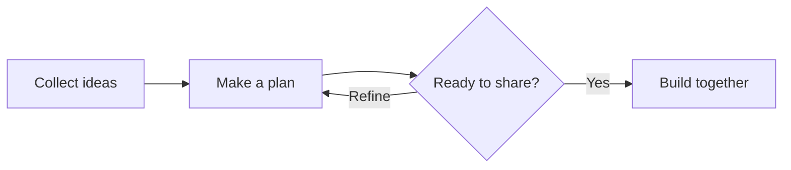

# Mermaid diagrams

Type **`/mermaid`** (or `/diagram`) in a page and choose **Mermaid**. The block
starts with a small flowchart. Choose **Edit diagram** to change its code and see
the preview update, then **Hide source** to leave just the diagram. **Copy Mermaid
code** copies the source. An ordinary code block can also use **Mermaid** in its
language selector.

Existing plain-text code blocks whose first non-comment line identifies a Mermaid
diagram also offer **Render diagram**. The action changes that block's language
to Mermaid in one undoable edit and keeps its exact source. It requires editing
permission, preserves explicitly selected programming languages and uses the
same native renderer, collaboration and published reader as fenced/slash blocks.
For other Mermaid sources, select Mermaid from the code-language menu.

Flowcharts, sequence diagrams and Mermaid's other built-in diagram types use the
self-hosted Mermaid renderer. No external rendering service or CDN receives the
document. Diagram colors follow the current Orvyn theme.

Diagrams are stored as ordinary collaborative code blocks with language
`mermaid`. Saving, history, permissions and collaboration use the existing
document model. Markdown paste/import recognizes fenced `mermaid` blocks, and
Markdown export preserves the original code. No schema migration is needed.
Readers get a diagram and can inspect/copy its source without editing it;
published snapshots also render their captured diagram code.

Syntax errors leave the code intact and show a recoverable preview message.
Previews are limited to 20,000 source characters and 500 edges. Larger code blocks
remain stored and exportable. Diagram links, callbacks, raw HTML, remote images
and external icon/font loading are disabled. The renderer runs in an opaque-origin
sandbox with no access to the authenticated page, application API or network
resources. Display configuration cannot relax the fixed security options.

The web build bundles pinned Mermaid locally into a separate hashed asset; the
browser loads it only when a diagram is present. Production assets include
precompressed gzip/Brotli variants. `dev`, `dev:web` and `build` generate the
renderer automatically; generated bundles are excluded from Git and Docker build
contexts.
