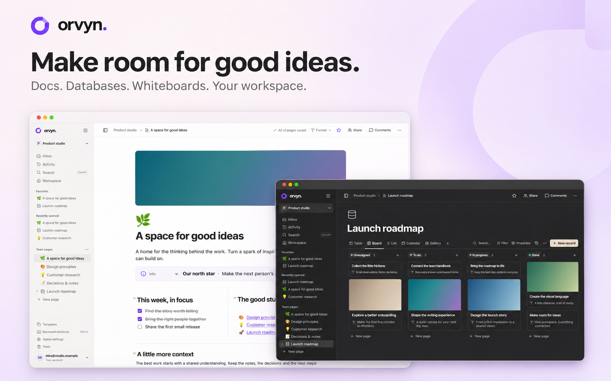

# Orvyn Helm chart

**Your knowledge. Organized.** · [Explore Orvyn](https://github.com/Lucas-Gruber/orvyn#readme) · [Releases](https://github.com/Lucas-Gruber/orvyn/releases)



This chart runs Web, API, email/attachment Worker, and Collaboration. PostgreSQL, authenticated Valkey, and private SeaweedFS can run inside the release or be replaced independently. Native filesystem attachments are also supported. Only Web is exposed through ingress; its Nuxt routes proxy `/api` and `/collaboration` to ClusterIP services. Worker has no Service. This is a single-instance internal infrastructure topology, **not a verified HA configuration**.

Chart `version`, `appVersion`, and all owned Node package versions are synchronized by `pnpm release:version`. An empty application image tag resolves to the exact `appVersion`; a digest takes precedence. SemVer build metadata (`+build`) maps to `_build` in Docker tags while the chart/package version retains the original SemVer. Published charts never resolve application images to `latest`. The source prepares **0.3.0-dev.0**; its matching images and OCI chart are not published. Version **0.2.0** remains the [released installation](https://github.com/Lucas-Gruber/orvyn/releases/tag/v0.2.0), with publicly pullable OCI chart and application images. Development source charts require images built from the same source; publishing a future version requires a completed release workflow.

## Requirements and first installation

Use Helm 3.22.1 or a compatible Helm 3 client, Kubernetes >=1.27, a dynamic default StorageClass (or existing PVCs), a working SMTP service, and a public HTTPS origin. A TLS ingress controller or upstream TLS terminator must already exist. cert-manager is optional. Allocate approximately 2 vCPU and 4 GiB RAM for a small test installation, in addition to cluster overhead; tune requests/limits for your workload. Default requests total about 700m CPU/896 MiB before transient Jobs, and each of the seven workloads has a 512 MiB memory limit. SeaweedFS, PostgreSQL and editor workloads may need more memory under load.

Create a namespace and an SMTP Secret using your existing secret-management tooling. The examples expect `orvyn-mail` with key `smtp-url`; values must be a valid `smtp://` or `smtps://` URL. Never commit real credentials or pass passwords in shell history. Configure `smtp.from` for your SMTP provider's verified sender. Other missing internal credentials and the 32-byte hexadecimal encryption key are generated by Helm CLI and retained for upgrades.

```sh
kubectl create namespace orvyn
# Create orvyn-mail in this namespace using your secret-management tooling.
helm upgrade --install orvyn ./infrastructure/helm/orvyn \
  --namespace orvyn --wait --wait-for-jobs --atomic --timeout 10m \
  -f infrastructure/helm/orvyn/examples/all-in-one.yaml \
  --set global.origin=https://notes.example.org \
  --set ingress.className=traefik
```

The bare defaults intentionally fail with a useful error until SMTP is supplied. Install the published OCI chart with the same configuration:

```sh
helm upgrade --install orvyn oci://ghcr.io/lucas-gruber/charts/orvyn \
  --version 0.2.0 --namespace orvyn --create-namespace \
  --wait --wait-for-jobs --atomic --timeout 10m -f your-values.yaml
```

The OCI chart and four application images are published by the **same** release workflow. Chart publication waits until every versioned image tag has been verified. The chart package is attached to the release and covered by signed `SHA256SUMS`; its OCI manifest is independently signed and verified with Cosign under the release workflow's GitHub OIDC identity. See [RELEASE.md](../../../RELEASE.md) for signature verification and immutable retry policy.

## Rancher and graphical configuration

For the source catalog, open **Apps → Repositories → Create**, choose **Git repository**, and enter:

- Name: `orvyn`
- Git repository URL: `https://github.com/Lucas-Gruber/orvyn.git`
- Branch: `main`
- Authentication: none (public repository)

Use the Git repository root, without a chart-directory suffix. Rancher scans chart directories recursively and discovers `infrastructure/helm/orvyn/Chart.yaml`, including its `questions.yaml`. This is an Apps catalog repository, not a Fleet GitRepo. The equivalent resource is:

```yaml
apiVersion: catalog.cattle.io/v1
kind: ClusterRepo
metadata:
  name: orvyn
spec:
  gitRepo: https://github.com/Lucas-Gruber/orvyn.git
  gitBranch: main
```

Catalog discovery and image availability are separate: `main` may contain a prepared version whose container images and OCI chart have not been published yet. Before installing, check that the matching `v<appVersion>` release has completed. Do not substitute older application images: the chart's configuration commands and migrations require the matching application version.

After the OCI chart is published and its GHCR package is public, Rancher versions with OCI catalog support can use the **exact chart** URL `oci://ghcr.io/lucas-gruber/charts/orvyn` (lowercase `oci://`). Do not use the parent `oci://ghcr.io/lucas-gruber/charts` as a catalog-discovery endpoint on GHCR. A `403 Forbidden` fetching a GHCR pull token means the chart is not anonymously available: it may be unpublished or its package visibility may be private. A published private package requires registry credentials; an unpublished version requires a completed release. Changing TLS verification does not resolve either condition. Older Rancher versions can use the Git catalog or install the released chart with Helm.

The form groups General, **Authentication**, Networking, PostgreSQL, Valkey, Storage, SMTP, **SSO (OIDC)**, **Database backups**, Scaling, Resources and Advanced. Choose an exact HTTPS URL, SMTP Secret, storage mode and optional SSO before installation. `global.showAdvanced` reveals images, probes, security and scheduling fields. Basic deployment, SSO, secrets, storage and resource settings have individual fields. Labels and node selectors use key/value controls. Arbitrary native Kubernetes affinity, toleration, probe and image-pull-secret structures use Rancher's supported YAML controls; these optional expert structures are not simulated as unsupported object selectors. StorageClass, Secret and PVC selectors use Rancher's actual reference field types. References must exist in the release namespace. Regeneration scripts and CI check all 322 questions against actual value paths/defaults.

## Configuration map

| Values                                                                      | Behavior                                                                                                                                                                                                                                                                                      |
| --------------------------------------------------------------------------- | --------------------------------------------------------------------------------------------------------------------------------------------------------------------------------------------------------------------------------------------------------------------------------------------- |
| `global.origin`                                                             | Public HTTPS origin without path/trailing slash. Controls cookies, callbacks, ingress host and TLS host.                                                                                                                                                                                      |
| `global.imageRegistry`, `global.imagePullSecrets`                           | Registry prefix for unqualified app repositories, and pull Secret references. Fully qualified dependency repositories retain their own registry.                                                                                                                                              |
| `global.generateSecrets`                                                    | CLI generation/reuse with `lookup`; disable for deterministic GitOps.                                                                                                                                                                                                                         |
| `global.encryptionKey` / `existingEncryptionSecret` / `encryptionSecretKey` | Explicit 64 hex characters, or a persistent external Secret key. Never change on an existing database.                                                                                                                                                                                        |
| `global.secretRevision`                                                     | Explicit rollout marker after changes to external Secret contents.                                                                                                                                                                                                                            |
| `web`, `api`, `worker`, `collaboration`                                     | Individual image repository/tag/digest/pullPolicy, replicaCount, requests/limits, nodeSelector/affinity/tolerations, pod labels/annotations, pod/container securityContext and startup/readiness/liveness probes. Empty probe objects disable a probe. Worker has no synthetic health server. |
| `web.service.type/port`                                                     | ClusterIP by default; optional NodePort or LoadBalancer. API and Collaboration remain ClusterIP.                                                                                                                                                                                              |
| `api.maxUploadBytes`                                                        | 1–104857600 bytes; default 10 MiB.                                                                                                                                                                                                                                                            |
| `postgresql.enabled`                                                        | Internal single-replica PostgreSQL StatefulSet; `auth.username/database/password/existingSecret/secretKey` configure it.                                                                                                                                                                      |
| `externalPostgresql.url/existingSecret/secretKey`                           | Full external PostgreSQL URL, preserving TLS parameters such as `sslmode=verify-full`. Used only when internal PostgreSQL is disabled.                                                                                                                                                        |
| `valkey.enabled`                                                            | Internal authenticated single-replica Valkey StatefulSet; `auth.password/existingSecret/secretKey`. Official pinned image uses UID/GID **999**; fsGroup 999 makes PVC data writable. Its CLI probes use the supported `REDISCLI_AUTH` variable (Valkey 8 retains this name).                  |
| `externalValkey.url/existingSecret/secretKey`                               | External `redis://` or `rediss://` connection for Collaboration when internal Valkey is disabled. Valkey is protocol-compatible with the existing Redis extension.                                                                                                                            |
| `collaboration.namespace`                                                   | Coordination key namespace; keep identical across replicas and distinct between installations sharing an external Valkey.                                                                                                                                                                     |
| `storage.driver`                                                            | `s3` (default, preserving existing application behavior) or `local`.                                                                                                                                                                                                                          |
| `storage.local.path/persistence`                                            | Private shared attachment directory and PVC options.                                                                                                                                                                                                                                          |
| `storage.s3.internal.enabled`                                               | Internal pinned SeaweedFS with private runtime S3 configuration and bucket initializer; no public S3 ingress.                                                                                                                                                                                 |
| `storage.s3.external.endpoint`                                              | Endpoint for an existing S3 service when internal SeaweedFS is disabled.                                                                                                                                                                                                                      |
| `storage.s3.bucket/region/forcePathStyle`                                   | Common S3 settings. External buckets must already exist and remain private.                                                                                                                                                                                                                   |
| `storage.s3.accessKeyId/secretAccessKey/existingSecret`                     | Inline credentials or one referenced Secret with configurable `accessKeySecretKey` and `secretAccessKeySecretKey`.                                                                                                                                                                            |
| `smtp.url/from/existingSecret/secretKey`                                    | SMTP URL and sender; only Worker receives SMTP credentials.                                                                                                                                                                                                                                   |
| `configuration.resources/activeDeadlineSeconds/backoffLimit`                | Resources for the configuration workload and storage bootstrap; deadlines/retry limits apply to the storage bootstrap Job.                                                                                                                                                                                                                                                      |
| `configuration.reconcileIntervalSeconds/retryIntervalSeconds` | Seconds between idempotent checks (30) and retries (5); range 1–300. |
| `serviceAccount.create/name/annotations`                                    | Dedicated account by default; no RBAC or mounted service-account tokens. Existing-account mode requires its name.                                                                                                                                                                             |

For every internal data service, `persistence` supports `enabled`, `existingClaim`, `storageClass`, `accessMode`, `size`, `annotations`, and `retain`. Component scheduling, resources, pod labels/annotations and security contexts are independently configurable. `global.storageClass` is the fallback; empty uses cluster default and `"-"` requests no class. Generated PVCs are separate resources so an allowed size increase can be patched; existing claims remain operator-managed.

## Local account registration

Development source 0.3.0 adds `auth.registration.enabled` (default `true`) and `auth.registration.allowedEmailDomains` (default `[]`). Rancher shows them under **Authentication**. Disabling self-registration rejects direct API requests and removes the login screen's account-creation action. Existing accounts can still sign in and recover passwords. A nonempty list restricts only **new local accounts** to exact domains, without wildcards or implicit subdomains:

```yaml
auth:
  registration:
    enabled: true
    allowedEmailDomains: [company.example]
```

To close local signup after establishing administrator access, set `enabled: false`. OIDC automatic provisioning remains controlled separately by `sso.oidc.autoProvision`; verified identities can still be provisioned through the configured provider. These rules do not add invitation-only signup or OIDC group mapping. The domain list is visible on the public login screen. Policy changes roll API pods; use the same values on all replicas. Published 0.2.0 images/chart do not support these settings. See [authentication behavior](https://github.com/Lucas-Gruber/orvyn/blob/main/docs/AUTHENTICATION.md#local-registration-policy).

## OIDC single sign-on

Use `examples/oidc.yaml` as an overlay. Configure `sso.oidc.enabled`, `issuer`, `clientId`, `clientAuthMethod`, and either `clientSecret` or `existingSecret` with optional custom `secretKey`. Methods are `client_secret_basic`, `client_secret_post`, and `none` for public clients using PKCE. Public clients cannot have a secret.

Preserve the exact discovery issuer, including trailing slashes. To repair an
issuer whose final slash was removed by older Orvyn versions, set the corrected
`issuer`; when linked identities exist, also explicitly set
`sso.oidc.repairLegacyIssuer: true`. Repair requires trusted metadata at the old
well-known endpoint, the same client ID and no duplicate provider. It preserves
historical provider UUIDs and external identities, revokes old provider sessions
and records an audit event. Restore the approval flag to `false` afterward while
keeping the corrected issuer. Other issuer/client changes do not use this repair.

Register this **exact** callback at the IdP:

```text
https://notes.example.org/api/v1/oidc/deployment/callback
```

`name` controls the sign-in button, `scopes` must include `openid`, and `autoProvision` defaults to false. When enabled it provisions only identities whose provider verifies their email. It never automatically links an existing local account by email. Optionally set `adminSubject` to an exact immutable subject from your IdP; this grants application administration to that identity only, not to every SSO user. Removing the value revokes that declarative grant. Existing locally granted administrators are preserved.

For a private CA, set `sso.oidc.ca.existingSecret` and `secretKey` to a PEM certificate. API and configuration workloads mount it using `NODE_EXTRA_CA_CERTS`; TLS verification remains enabled. All API replicas read the provider from PostgreSQL. A dedicated single-replica **configuration Deployment** applies advisory-lock-protected migrations and continuously reconciles the desired provider. It starts independently of API and storage readiness, retries failures and recovers without another Helm upgrade. `Recreate` updates stop the previous configuration process before starting the next; GitOps manages it as a regular resource. API uses `ORVYN_OIDC_BOOTSTRAP_MODE=external` with independent readiness. **Only the configuration workload receives the OIDC client secret.** Provider secrets are encrypted in the database using the persistent encryption key. The managed provider is read-only in the application administrator UI; manually configured providers remain supported. Disabling deployment SSO disables/revokes only its managed provider/sessions. Issuer/client identity changes do not relink existing users.

`configuration.reconcileIntervalSeconds` (30) and `retryIntervalSeconds` (5) control idempotent checks/retries in whole seconds (1–300). Readiness is set after the desired configuration succeeds and expires if the process stops progressing. `configuration.resources` also applies to this steady workload. Deadlines/backoff limits remain for internal storage bootstrap Jobs. Changes to unrelated settings preserve an unchanged encrypted client secret.

During Helm upgrades, a short compatibility hook with the legacy Job name lets Helm retire an unfinished old configuration hook before the reconciler starts. It uses the API image and Node without database credentials, PVCs, application secrets or a Kubernetes token. GitOps renderers manage the new Deployment and should prune any retired legacy hook Job. Rollbacks of configuration values retain accounts/attachments; application rollback across newer database migrations requires a compatible version or database recovery.

This is OIDC, not SAML, group synchronization or SCIM. Local account recovery remains available. A real Keycloak login with discovery, PKCE, signed tokens/JWKS, verified provisioning and subject-specific administration is covered by application integration tests.

## Storage modes and persistence

- **Internal S3:** `storage.driver=s3`, `storage.s3.internal.enabled=true`. SeaweedFS runs as UID 1000 with a dedicated PVC. An init container creates private `s3.json` from Secret references into an in-memory volume. A **normal Job**, not a post-install hook, creates/checks the bucket and tests object writes/reads. API readiness can therefore become healthy during `--wait --atomic`. Job names include their configuration hash so upgrades never patch immutable Job pod templates.
- **External S3:** disable internal storage and configure endpoint, bucket, region, path-style and credential references. No internal StatefulSet, PVC or bucket initializer is rendered. The chart never creates or modifies external buckets. Restrict bucket access to Orvyn and verify anonymous reads are denied.
- **Native local:** `storage.driver=local` removes internal S3 resources. API and Worker share one PVC and storage path. `ReadWriteOnce` is restricted to one API and one Worker; required pod affinity colocates them on one node. `ReadWriteMany` supports replicas on different nodes when the storage system provides shared POSIX semantics. This alone does not establish HA. An existing PVC must be writable for UID/GID 1000. See [STORAGE.md](../../../docs/STORAGE.md) for file permissions, hashing, atomic writes, streaming, cleanup and migration constraints.
- **Ephemeral:** `persistence.enabled=false` uses emptyDir for internal data services. Ephemeral local attachments place Worker alongside API in one Pod sharing emptyDir; both replica counts must be one, and API's pod scheduling/security settings govern the shared pod. Worker container resources/security/probes still apply. Pod replacement loses files. No ephemeral mode is appropriate for durable production data.

Persistence access mode, StorageClass and existing claim selection are not live migration mechanisms. Increasing a generated claim's size requires StorageClass expansion support; Kubernetes cannot shrink it. Class/access-mode changes need a new claim and verified data migration. PostgreSQL database/user/password settings initialize **empty** data only. Changing them does not rename or rotate an existing database. Deliberately rotate credentials at the database and referenced Secret together. The chart rejects a changed inline generated PostgreSQL password or encryption key when the previous retained Secret is readable; GitOps rendering cannot enforce runtime data invariants and requires operator discipline.

## Secrets, rollouts and GitOps

`examples/gitops.yaml` supplies all required Secret references and disables generation. It renders deterministically without `lookup`; precreate credentials through External Secrets, SOPS, Sealed Secrets or your existing secure tooling. The encryption key must be backed up separately from Git. Never regenerate it during chart reconciliation.

Generated credentials live in `<fullname>-secrets`, marked `helm.sh/resource-policy: keep`; Helm CLI reuses their existing values. Credentials are selected with individual `secretKeyRef` entries, not broad `envFrom`. Web receives none; Collaboration gets database/Valkey; API gets database/encryption/storage; Worker gets database/encryption/storage/SMTP; the configuration workload gets database/encryption/OIDC only. Internal PostgreSQL uses literal PG fields plus a password reference, so special characters and external password Secrets need no template-time URL construction or lookup. SeaweedFS similarly builds its private configuration at runtime from selected keys.

Configuration checksums never include newly generated random data. Relevant settings and Secret references roll pods; external Secret **contents** cannot be observed by a renderer. After a referenced Secret rotation, update `global.secretRevision` and perform an upgrade/reconciliation. The independent configuration workload applies changed OIDC credentials on rollout and reconciliation. For the generated central Secret, keep its existing password/encryption material; database password and encryption changes require an explicit migration process.

Flux HelmRelease and Argo CD manage the configuration Deployment as a regular workload, alongside the ordinary storage bootstrap Job, StatefulSets and application deployments. Keep the usual Deployment/Job health assessment. Configuration readiness is independent of API readiness and does not depend on a PostSync hook. Helm upgrades retire the legacy hook Job through the compatibility hook described above; raw GitOps renderers should prune that retired resource. `--atomic` rolls back Kubernetes resources but does **not** roll back database migrations or transactionally undo provider/session changes. The ordinary CLI's retained Secret lookup differs from deterministic rendering; select the GitOps example before first install.

## Persistent volume permission preparation

`volumePermissions.strategy` applies consistently to persistent PostgreSQL,
Valkey, local API/worker attachments, SeaweedFS and backup mounts. Target UID/GID
comes from each container's SecurityContext, then the Pod, then its image's
documented default (999 for PostgreSQL/Valkey/backups, 1000 otherwise). Ownership
uses the Pod's `fsGroup` when set, otherwise the runtime GID. Shared local API and
worker mounts require the same UID and volume group; the chart rejects mismatches.

| Strategy | Startup behavior | Pod Security |
| --- | --- | --- |
| `auto` (default) | Probe as the actual service UID; attempt root repair if needed; verify again as the service UID. Healthy mounts skip ownership walks. | Root repair init requires a narrowly scoped policy exception. |
| `fsGroup` | Only non-root preparation and a real write/rename/fsync probe. Use when kubelet/CSI handles ownership, or the server pre-provisions it. | Compatible with Restricted when the other workload settings also comply. |
| `initContainer` | Explicit repair followed by real non-root verification. | Same root init exception as auto. |
| `none` | No helper containers or preparation; operator supplies correct mounts. | No added exception; startup still checks attachment storage. |

Auto always **renders** its root repair init container; policy admission evaluates
the whole Pod even when its repair phase will skip. Choose `fsGroup` for Restricted
namespaces rather than weakening namespace or cluster policy. Regular containers
continue to run non-root. Root helper defaults drop ALL capabilities and add only
CHOWN, FOWNER and DAC_OVERRIDE, with no privilege escalation, writable rootfs,
privileged mode, service-account token, database credentials or application secrets.
It mounts only its own data volume plus a small per-Pod state volume. Permission
preparation precedes schema waits and private S3 configuration.

`volumePermissions.recursive=onRootMismatch` repairs a mismatched root/critical
service directory and its affected tree. An on-volume incomplete marker resumes
interrupted repairs even after the boundary owner changed. `always` explicitly
scans existing descendants (e.g. an imported tree with mixed ownership); `never`
requires correct descendant ownership. Private attachment/backup directories are
tightened by their owner after kubelet fsGroup preparation when necessary. Data
bytes are preserved. Symlinks, hardlinks, nested mounts and `lost+found` are not
followed. The helper does not delete/recreate PVCs or use chmod 777. Existing
contents must belong exclusively to the intended Orvyn component.

Configure helper `resources`, root `securityContext`, and non-root
`probeSecurityContext` under Volume permissions (expand Advanced for image/security
fields). An empty helper `image.repository` inherits the **complete API image**,
including digest and pull policy. An override must contain the matching compiled
Orvyn Node helper at `/app/dist/commands/volume-permissions.js`; arbitrary BusyBox
or database images are incompatible. Keep helper/application/chart versions aligned.

**Democratic CSI / TrueNAS NFS:** `fsGroup` is not evidence that a driver or export
actually permits writes. The reported `org.democratic-csi.nfs` / `freenas-api-nfs`
case provisioned `root:root/0755`; non-root services cannot create their data there.
Auto can correct it only if the export authorizes the ownership operation. With
root squashing, a root init may also receive EPERM/EACCES. Its structured diagnostic
includes mount, expected/effective UID/GID, fsGroup, owner, mode, operation and a
server-side ACL action. The final non-root verification must pass; denied root
repair never counts as successful readiness. Correct the numeric owner and
appropriate inherited dataset ACLs **on the storage server/provisioner**. Private
existing files require the service's numeric owner, not merely a matching group.
Do not disable root squashing or make exports publicly writable. After correction
the failed verification init retries automatically; no second Helm upgrade is needed.
See the [NFS + Authentik example](examples/nfs-authentik.yaml).

Use `fsGroup` with working CSI block storage, Longhorn or local-path provisioning
after validating their actual policy, and auto/initContainer where explicitly
allowed. Existing claims and RWO/RWX retain the chart's normal binding/scheduling
rules. Multi-node attachments require shared RWX POSIX rename/fsync semantics;
permission preparation does not turn node-local storage into shared storage.
Container fixtures cover correct/root-owned/denied mounts, actual UIDs,
interrupted and concurrent repairs. They simulate denied chown, **not a real NFS
server**. TrueNAS/Democratic CSI, root-squashed NFS, Longhorn and k3s local-path
have not been validated against their actual backend in this environment.

## Networking and TLS

Ingress host and TLS host are derived exclusively from `global.origin`. `ingress.className` and `annotations` select/tune your controller. To use an existing TLS certificate set `tls.enabled=true` and `tls.secretName`. To issue one with cert-manager also set `tls.issuer` and `tls.issuerKind` (`Issuer` or `ClusterIssuer`); the issuer must exist. With `tls.enabled=false`, HTTPS must terminate at an upstream proxy/load balancer and the origin remains the public **HTTPS** URL. Production cookies are Secure; plain HTTP origins are rejected. Disabling ingress supports an independently managed HTTPS gateway or test access.

Your controller must preserve HTTP upgrade headers and allow long WebSocket connections on `/collaboration`. Traefik normally does so automatically. For ingress-nginx, consider `nginx.ingress.kubernetes.io/proxy-read-timeout: "3600"`, `proxy-send-timeout: "3600"`, and `proxy-body-size: "100m"` (or your smaller configured limit). Configure controller request-size limits to accommodate uploads. Browser connections use the page's HTTPS origin and WSS; never expose a second collaboration port or hardcode a client-side localhost URL.

## Backups, upgrade and recovery

The development chart adds optional scheduled **PostgreSQL-only** snapshots under `backup` (not included in published chart 0.2.0). Enable `backup.enabled`, set `schedule`, `timeZone` and `retentionCount`, and choose its retained PVC through `backup.persistence`. The [database backup example](examples/database-backup.yaml) defaults to 02:17 UTC and seven completed snapshots. The CronJob and manual Jobs share an exclusive filesystem lock; only a verified new custom-format archive permits retention of older snapshots. Jobs run as UID/GID 999 by default, receive only database credentials and use a pinned PostgreSQL 17 client. For an external server select a compatible `backup.image` and optionally a CA Secret under `backup.ca`. A digest takes precedence over the tag.

A regular backup-volume initialization Job binds delayed `WaitForFirstConsumer` claims during installation, including with `backup.suspend=true`, and verifies writable non-root storage, locking, directory rename and syncing. It receives no database or application credentials and creates no snapshot. Its name changes with relevant configuration to permit immutable Job-template upgrades. This avoids waiting for a nightly CronJob to consume the backup PVC while Helm waits for the volume to bind.

The PVC snapshots are unencrypted and remain in the cluster. They do not include attachment bytes or the encryption key. Protect and size the volume for retained snapshots plus one new dump, and arrange coordinated attachment/key protection and encrypted offsite copies. The [backup and recovery guide](https://github.com/Lucas-Gruber/orvyn/blob/main/docs/BACKUP.md#scheduled-postgresql-snapshots-on-kubernetes) includes manual backup commands and an isolated restore Job that verifies checksums, refuses every existing target and creates only a new `orvyn_restore_*` database. No running service is switched automatically. Filesystem locking, atomic rename and syncing must be supported by the chosen volume.

Back up PostgreSQL, attachment storage and `ORVYN_ENCRYPTION_KEY` as one recoverable set. Include referenced SMTP/S3/OIDC configuration through your secret-management backup process. Verify restorations before upgrades. Prefer a coordinated maintenance window or database/storage snapshots with consistent application writes paused. Valkey is coordination infrastructure, not the source of durable documents; PostgreSQL is authoritative. PostgreSQL/SeaweedFS filesystem copies require a valid coordinated snapshot or stopped services, not an uncoordinated live volume copy. Retained PVCs and Secrets survive normal uninstall; deleting a namespace or externally managed claim can still delete them.

API replicas run database migrations under a PostgreSQL advisory lock; the configuration reconciler uses the same migration machinery. SIGTERM drains the API and collaboration service, stops worker loops and closes pools. Readiness checks dependencies; API liveness checks its process separately. Rolling back the chart cannot roll back SQL migrations. The pre-chart 0.1.1 binary refuses unknown newer schema versions: restoring its old binary requires a coordinated verified database/storage/key backup. Configuration-only rollbacks within a compatible binary replace the reconciler and reapply the desired values. Test upgrades on restored staging data first.

There is **no automatic storage-driver migration**. Changing drivers/endpoints/claims on a populated database does not copy attachments. Use the maintenance-and-verify procedure in STORAGE.md and preserve exact object keys and bytes. Never point an existing database at an empty replacement bucket/PVC.

The earlier unshipped chart used lowercase `chart.yaml`, empty schema, `appVersion: latest`, legacy `storage.internal`, `storage.external`, and top-level `storage.bucket/region/forcePathStyle/accessKeyId/secretAccessKey`. Move these to `storage.s3.internal`, `storage.s3.external.endpoint`, and `storage.s3.*`; credentials now use `storage.s3.existingSecret`. Ingress host/path lists are replaced by central origin and `ingress.tls` fields. The schema rejects old keys instead of silently selecting another data store. Resource/PVC names and layout also changed: **do not run this chart over a populated hand-installed legacy chart without inventorying existing claims/Secrets, setting explicit existingClaim references, and verifying backups**. Default fullname is `<release>-orvyn`; keep it stable after installation.

## Checks and troubleshooting

Run `node scripts/test-helm.mjs` for Helm lint, JSON schema, 21 mode combinations, negative configuration cases, Rancher defaults, long SemVer/name validation, strict Kubeconform validation, and the rendered authenticated probes against a real pinned Valkey container (pinned tools in Docker). `node scripts/package-helm.mjs` produces a deterministic archive used by CI/releases. `node scripts/test-kubernetes.mjs` uses checksum-verified Kind 0.33.0, the four built `orvyn/<component>:ci` images and a disposable cluster: it installs with wait/atomic, tests authenticated attachments, runs a CronJob-derived backup and isolated restore on the retained PVC, upgrades to two APIs, closes registration, applies OIDC configuration, verifies unchanged generated secrets, rolls configuration back, and tests a local shared PVC across upgrade. It deletes only its own cluster. Rootless Docker requires working cgroup delegation; this Cloud host lacks it, so local real-cluster results are unavailable. CI runs that test on a normal Ubuntu runner; inspect the current run before treating it as passed.

For failed installs inspect `kubectl get pods,jobs,pvc -n orvyn`, pod descriptions/events and the failed Job's logs. Do not dump Secrets or container environments into tickets. Pending PVCs usually mean an unavailable StorageClass or access mode; local RWO Pending pods can indicate conflicting node selectors. A failed storage initializer indicates endpoint/credentials/volume readiness; failed API readiness indicates database or bucket access. Verify the exact origin and IdP callback if SSO fails, and inspect `kubectl logs deployment/<release>-orvyn-configuration` if the provider is absent. When `--atomic` removes resources after an initial failure, repeat on an isolated test namespace without `--atomic` to retain diagnostics, using the same durable Secret and existing claims. Never solve authentication errors by deleting a populated database or encryption Secret.
